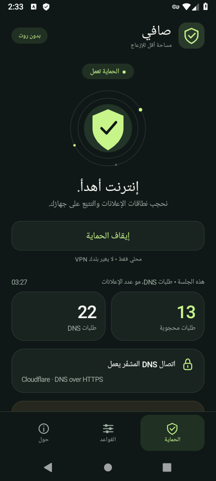

# صافي — Safi

<!-- github-downloads -->
> 🔒 هذا مستودع خاص. يلزم تسجيل الدخول بحساب لديه صلاحية لعرض الكود وتنزيل الإصدار.

**[تنزيل التطبيق APK وملف المصدر](https://github.com/Pomtoto/safi-adblock/releases)** · [طريقة التثبيت](INSTALL-AR.md) · [البناء داخل GitHub](CI.md) · [نتائج الاختبار وحدوده](TESTING.md)

<p align="center"></p>
<!-- /github-downloads -->


حاجب نطاقات إعلانات وتتبّع للأندرويد **بدون روت**. تطبيق أصلي بواجهة عربية، وليس صفحة ويب أو تعديلًا على التطبيقات الأخرى.

> النسخة الحالية 1.1.0 تجريبية. لا يستطيع حاجب DNS إزالة كل الإعلانات. اقرأ حدود العمل أدناه قبل التثبيت.

## جديد في 1.1.0

- **قوة الحجب**: الوضع الخفيف السابق افتراضيًا، وخيار NORMAL أوسع (191,639 نطاقًا مضمّنًا).
- **فحص DNS اختياري**: موافقة منفصلة، دقيقتان، حتى 128 صفًا في RAM فقط، دون رفع تلقائي. قد يضم طلبات أي تطبيق مفتوح؛ ليس تحديدًا دقيقًا لتطبيق واحد.
- النتائج تُمسح عند إيقاف الحماية أو المسح أو انتهاء صلاحية الاحتفاظ. النسخ للحافظة يدوي وبعد المراجعة.
- **هذا تحديث تشخيصي، وليس إصلاحًا مؤكّدًا لإعلان Passion Drama Lite.** حجب إعلان فتح حلقة قد يمنع فتح الحلقة؛ لا توجد مكافآت أو حلقات تُفتح تلقائيًا.

ابدأ من [دليل تجربة الحجب والتشخيص](DIAGNOSTICS-AR.md).

## التشغيل

1. انسخ `Safi-1.1.0-github.apk` إلى هاتف أندرويد 8.0 أو أحدث وثبّته. إذا طُلب ذلك، اسمح بالتثبيت من المتصفح أو مدير الملفات الذي فتحته فقط. لا يحتاج التطبيق تعطيل Play Protect أو تثبيت شهادة.
2. افتح **صافي** واضغط **تشغيل الحماية**.
3. اقرأ توضيح الخصوصية ووافق على طلب اتصال VPN من أندرويد. الإشعار يتيح إيقاف الحجب في أي وقت.
4. أغلق التطبيق الذي تظهر فيه الإعلانات وافتحه مجددًا. الإعلانات المحمّلة مسبقًا وذاكرة DNS السابقة قد لا تختفي فورًا.
5. من **القواعد**، حدّث القائمة عند الحاجة، أو استثنِ تطبيقًا/نطاقًا إذا تعطل.

يعمل أيضًا على جهاز مروّت، بنفس وضع VPN المحلي، **ولا يطلب أو يستخدم الروت**. ليس فيه وضع تعديل ملف hosts.

## المزايا الفعلية

- VPN محلي لتصفية DNS فقط؛ بقية الاتصالات لا تمر عبر خادم VPN تابع للتطبيق.
- قائمة HaGeZi Multi LIGHT الافتراضية مضمّنة: **36,608 نطاقات** عند البناء، الإصدار `2026.0907.0809.33`.
- يمنع النطاقات المطابقة وفروعها برد DNS من نوع NXDOMAIN قبل إرسالها للخارج.
- حلّ أسماء النطاقات المسموحة عبر Cloudflare DNS over HTTPS، مع التحقق الافتراضي من شهادات TLS وأسماء الخوادم.
- نطاقات مسموحة، حجب يدوي، واستثناء تطبيقات ذات أيقونات تشغيل. السماح يتقدّم على الحجب.
- يدعم نقل DNS المحلي عبر UDP وTCP، وردود A وAAAA وغيرها من أنواع DNS القياسية ذات سؤال واحد.
- عند تجاوز الرد حجم UDP المناسب، يعيد إشارة TC، مع دعم إعادة المحاولة عبر TCP.
- ذاكرة DNS مؤقتة محدودة في RAM، مع احترام TTL، وتُمحى عند إيقاف الاتصال.
- عدادات فعلية لطلبات DNS والمحجوب منها؛ **ليست قياسًا لعدد الإعلانات المرئية التي أزيلت**. العدادات فقط محفوظة بين مرات فتح التطبيق.
- تحديث القائمة يدويًا عبر HTTPS، مع فحص الصيغة والحجم والحفاظ على النسخة السابقة عند الفشل.
- لا حسابات، ولا إعلانات داخل التطبيق، ولا SDK تحليلات أو تتبّع.

## حدود مهمة

- إعلانات يوتيوب، وإعلانات تأتي من نفس نطاق المحتوى، كثيرًا ما لا يمكن حجبها بهذه الطريقة.
- DNS الآمن الخاص داخل التطبيق أو المتصفح، وعناوين IP المباشرة، وDNS الخاص المضبوط على مزوّد محدد، قد تتجاوز الحجب.
- إذا لم يعمل الحجب، راجع إعداد **DNS الخاص** واجعله تلقائيًا أو إيقافًا. راجع كذلك إعداد DNS الآمن داخل المتصفح.
- بعض الألعاب تشترط مشاهدة إعلان للحصول على مكافأة؛ الحجب قد يمنع المكافأة أو يعطل جزءًا منها.
- قد تبقى مساحات فارغة بدل الإعلانات؛ التطبيق لا يعيد تصميم واجهات التطبيقات الأخرى.
- لا يعمل بالتزامن مع VPN آخر. لا تستخدم معه خيار **حظر الاتصالات بدون VPN**. دعم Always-on معطّل لأن هذا ليس نفقًا لكل حركة الإنترنت.
- الحماية تُشغَّل يدويًا بعد إعادة تشغيل الهاتف، وليست خدمة إقلاع تلقائي.
- إذا كان Cloudflare محجوبًا أو انقطع الإنترنت، قد تتوقف أسماء المواقع الجديدة عن العمل حتى يعود الاتصال أو توقف الحماية. لا توجد عودة صامتة إلى DNS غير مشفّر.
- لا يوجد تفكيك TLS أو اعتراض HTTPS، ولا شهادة تثبتها على الهاتف، ولا صلاحية قراءة الرسائل أو الملفات.
- نقل DNS إلى الواجهة الافتراضية يستخدم IPv4، لكنه يدعم استعلامات IPv6/AAAA ويسمح باتصالات IPv6 العادية خارج النفق. حزم IP المجزأة والأسئلة المتعددة في رسالة DNS واحدة ليست مدعومة.

## الخصوصية والجهات الخارجية

- تُقرأ أسماء النطاقات في الذاكرة لإجراء المطابقة. بشكل افتراضي لا يوجد سجل أسماء محفوظ أو تحليلات. الفحص الاختياري، بعد موافقة منفصلة، يحتفظ بأسماء وقرارات DNS مؤقتًا في RAM فقط، وقد يشمل أي تطبيق مفتوح. لا يرفع التقرير تلقائيًا؛ مشاركته تتطلب نسخًا يدويًا ومراجعتك.
- النطاقات المسموحة تُرسل مشفّرة إلى **Cloudflare**؛ يستطيع مزود DNS رؤية تلك الطلبات وعنوان الاتصال. التطبيق ليس وسيلة إخفاء هوية.
- عند الضغط على **تحديث القائمة** فقط، يتصل التطبيق بـ `raw.githubusercontent.com`. يبقى ملف القائمة في التخزين الخاص بالتطبيق.
- الإعدادات والقائمة المحدّثة والعدادات مخزّنة على الجهاز. النسخ الاحتياطي التلقائي للتطبيق معطّل.
- صفحة الخصوصية: https://developers.cloudflare.com/1.1.1.1/privacy/public-dns-resolver/
- توثيق DoH: https://developers.cloudflare.com/1.1.1.1/encryption/dns-over-https/make-api-requests/

## البناء من المصدر

### Android Studio / Gradle

- JDK 17، Android SDK Platform 35، وBuild Tools 35.0.0.
- افتح هذا المجلد كمشروع Android Studio أو نفذ:

```bash
./gradlew :app:assembleDebug
```

الناتج في `app/build/outputs/apk/debug/app-debug.apk`. يوجد Gradle Wrapper مثبت الإصدار مع SHA-256 لتوزيعة Gradle. يحتاج التنزيل الأول إنترنت وموافقتك على تراخيص SDK ضمن أدوات أندرويد.

### بناء خفيف دون Gradle — Linux

يتطلب JDK 11 أو أحدث (مع `javac` و`jar` و`keytool` في PATH)، وPython 3 وzip وSDK المذكور:

```bash
export ANDROID_SDK_ROOT=/path/to/android-sdk
bash tools/build-apk.sh
```

الناتج: `artifacts/Safi-1.1.0.apk`. ينشئ السكربت مفتاح توقيع محليًا في `$HOME/.cache/safi-signing.jks` إن لم تحدد `SAFI_KEYSTORE`، بكلمة مرور تطوير افتراضية `android`. **لإصدار إنتاجي، استعمل مفتاحك وكلمة مرورك الخاصة، ولا تنشر المفتاح.** يمكن ضبط `SAFI_KEYSTORE`, `SAFI_KEY_PASS`, `SAFI_KEY_ALIAS`.

مفتاح توقيع ملف APK المرفق غير مرفق بالمصدر. بناء نسخة بمفتاح مختلف يحتاج إزالة النسخة الحالية قبل التثبيت، ما يمسح إعداداتها. ملف APK للتثبيت المباشر وليس إصدارًا منشورًا على متجر Play.

## الاختبارات

```bash
bash tools/test-core.sh          # اختبارات محلية، بلا اتصال إنترنت
bash tools/test-core.sh --live   # يضيف استعلام example.com حقيقيًا عبر DoH
```

تفاصيل الاختبارات وحدود التحقق الأصلية في `TESTING.md`، وإضافات هذا الإصدار في `tests/UPDATE-1.1.md`. الإصدار مشترك بين Gradle وسكربت البناء الخفيف عبر `app/version.properties`. البناء الخفيف يستخدم AAPT2 وjavac وD8 وzipalign وapksigner الرسمية. لا يتضمن التطبيق أي شهادة أو استثناء TLS خاص ببيئة الاختبار.

## الترخيص والمصادر

- كود صافي: © 2026 Safi contributors، **GPL-3.0-only**، بلا ضمان. الرخصة كاملة في `LICENSE` وداخل التطبيق.
- قائمة HaGeZi: النسخة الأصلية بدون تعديل في `app/src/main/assets/hagezi-light.txt` و`hagezi-normal.txt`، مع GPL v3 وملفات مصادر التجميع والبيانات الوصفية لكل منهما.
- المرجع المثبت: `c22e2f96fd9565f928d6ce22ddc41022042356f7` من https://github.com/hagezi/dns-blocklists
- بيانات المصدر والبصمة والإصدار في `app/src/main/assets/blocklist-info.json` و`normal-info.json`.
- Gradle Wrapper: مشروع Gradle، رخصة Apache-2.0؛ انظر `licenses/Apache-2.0.txt`.
- التطبيق مستقل، وغير تابع لـ Cloudflare أو HaGeZi أو Arena.ai، ولا يدّعي موافقتها أو ضمانها.

يمكن إعادة توزيع المصدر والنسخة الثنائية وتعديلهما وفق الرخصة. عند توزيع APK، أرفق المصدر المقابل كاملًا مع الرخصة.
